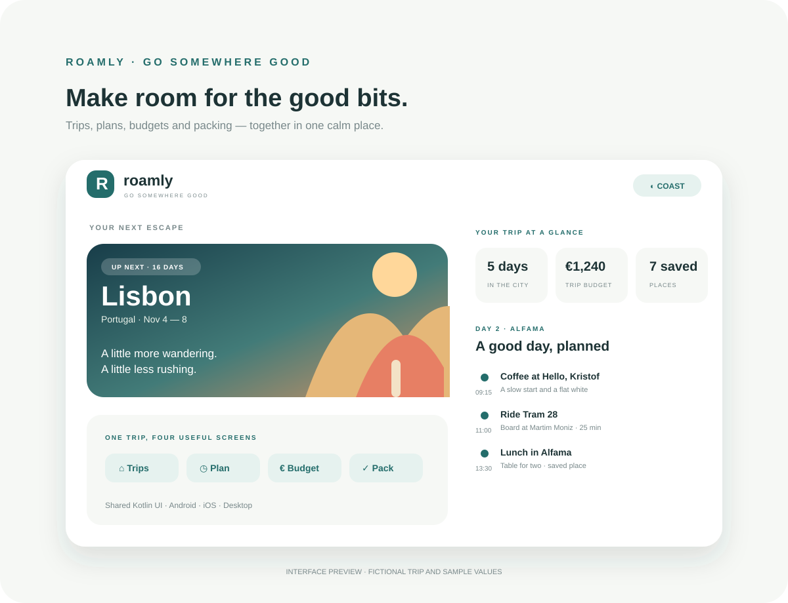

<div align="center">
  
  <h1>RoamlyKMP</h1>
  <p><strong>Go somewhere good.</strong><br/>A calm, thoughtfully designed trip planner built with Kotlin Multiplatform and shared Compose UI.</p>
  <p>
    
    
    
  </p>
</div>



> The image above is a vector interface preview. The app currently uses a fictional Lisbon trip and local sample data.

## What’s inside

- **Trips:** a Lisbon overview, quick trip details, saved stay, and a day preview.
- **Plan:** five selectable itinerary days with activities, times, and travel notes.
- **Budget:** category summaries, remaining trip budget, and a working sample expense action.
- **Packing list:** tappable checklist items with a live packed count.
- **Three themes:** Coast, Dune, and Midnight.
- **Shared UI:** the same Compose screen code is used across Android, the iOS framework, and desktop.

## Project layout

- `:androidApp` — Android application entry point and launcher icon.
- `:shared` — common Compose UI, iOS framework, and desktop application entry point.

## Build

Use Gradle 8.12.1 and JDK 17.

```sh
gradle :androidApp:assembleDebug
gradle :shared:run
gradle :shared:linkDebugFrameworkIosSimulatorArm64
```

The iOS framework target is configured for device and simulator architectures. An iOS host app can consume the generated `RoamlyShared` framework.

## Design notes

The app is a portfolio demo. It stores no account, location, payment, or personal trip data, and it does not call external travel services. The itinerary and prices are illustrative sample content. The packing checklist and sample expense button demonstrate interactive shared state.

## License

No license has been added yet.
